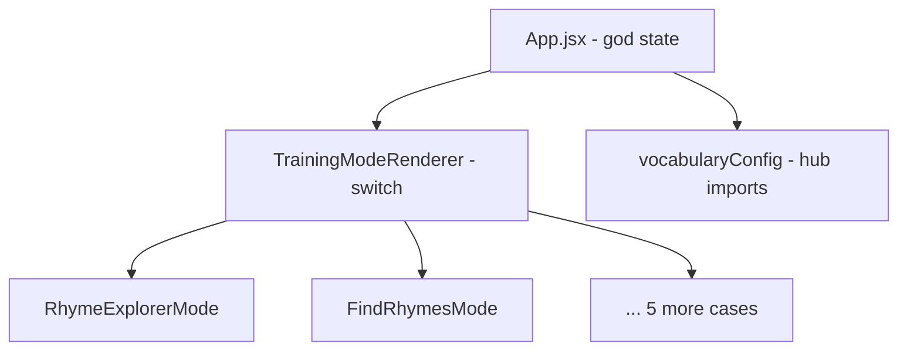
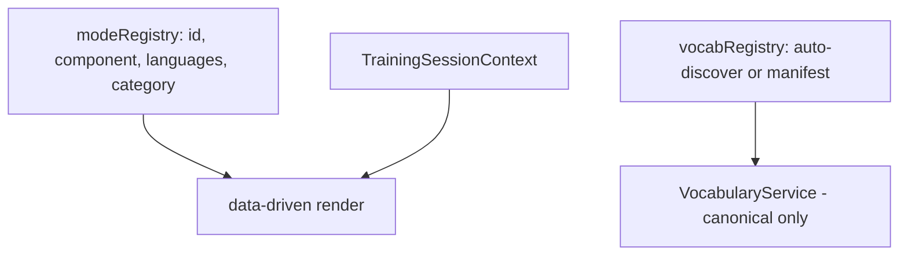

# Architectural Review — Web App

**Date:** June 2025  
**Scope:** Full codebase review focused on future-proofing, term consistency, and structural friction for adding features (modes, languages, vocabularies).

**Status:** Product terminology decisions locked (see below). Ready to begin implementation refactors.

---

## Product Decisions (locked)

Decisions from product review — use these as the source of truth for user-facing copy and refactor targets.

| # | Topic | Decision |
|---|--------|----------|
| 1 | Backing track | User-facing term: **instrumental** (not “beat” / “track” in UI) |
| 2 | `rhyme-explorer` mode name | User-facing: **Single Rhymes** (retire “Rhyme Explorer” in UI/docs) |
| 3 | Word collections | User-facing term: **vocabulary** |
| 4 | Rhyme Search & Lyrics Notepad | **FI only for now** (intentional; EN later if needed) |
| 5 | Custom vocabulary | **FI only for now** |
| 6 | Rhyme result tiers | Keep **Exact / Extended / Partial** |
| 7 | Themed vs dictionary rhymes | **One flat list** in UI — no “themed rhymes” / “other rhymes” labels; vocabulary vs full-dictionary sourcing is internal ranking only (theme words first, then fill from dictionary) |
| 8 | Bar vs round | **Bar** = always one 4/4 count. **Round** = one game turn (measured in bars). Standardize labels per mode: e.g. “Bars per word”, “Setup length (bars)”, “Bars between spins” |
| 9 | Mode categories | Keep **Training Modes** vs **Tools** split |
| 10 | Cross-language vocab lists | **No need to match** — lists reflect cultural needs per language |
| 11 | Rhyme Map name | **Neutral** — “Rhyme Map” (not “English Rhyme Map” etc.) |
| 12 | Product name | **Rheemy** — only public/user-facing brand name |

### Implementation notes from decisions

- **Instrumental:** Rename user-facing strings and translation keys (`training.beats.*` → instrumental wording). Code may keep `selectedBeatId` etc. internally; disambiguate rhythmic `currentBeat` → `beatInBar` / `beatPosition`.
- **Single Rhymes:** Route ID `rhyme-explorer` can stay for URLs; update display names in `trainingModes.js`, README, and android docs.
- **FI-only tools:** Gate at route/renderer level, not only `ModeSelector`. Remove or hide EN translation blocks for lyrics-writing until EN ships.
- **Flat rhyme lists:** Remove unused `themedRhymes` / `otherRhymes` copy from `trainingModes.js` when refactoring; keep `isThemed` only in services for sort priority.
- **Bar labels:** Unify `barCountLabel` / `barLengthLabel` under one key pattern with mode-specific strings per table above.

---

## Executive Summary

The app has a sensible high-level split (`data/` → `services/` → `hooks/` → `components/`), but several concepts are named differently in different layers, registration is manual everywhere, and a half-finished vocabulary/rhyme migration leaves parallel code paths.

The biggest risks for adding features are:

- Overloaded **beat** terminology
- Dual vocabulary formats
- FI-only modes hidden only in the UI
- No registry pattern for modes or vocabularies

---

## Term Mismatch Table

| Concept | Variants in codebase | Where | Risk |
|--------|----------------------|-------|------|
| **Backing track** | `beat`, `selectedBeatId`, `currentBeatId`, `training.beats.currentBeat` | `BeatSelector`, `AudioService`, translations | **→ UI: instrumental.** Collides with rhythmic beat (below) |
| **Rhythmic beat (0–3 in bar)** | `currentBeat`, `beat` in logs | `useAudioController`, training modes | Same word, different meaning |
| **Training mode** | `mode`, `training mode`, `selectedMode`, `modeId` | Routes, config, components | Mostly OK |
| **Mode display name** | ID `rhyme-explorer` → UI **"Single Rhymes"** → docs still **"Rhyme Explorer"** | `trainingModes.js`, README, android docs | **→ Standardize on Single Rhymes** |
| **Vocabulary** | `vocabulary`, `vocab`, `word list`, `wordList`, `dictionary`, `sanasto` (FI UI) | Services, editor, rhyme map | **→ UI: vocabulary** (internal names may vary) |
| **Full dictionary** | `EN__full_dict.js` (file), `en_full_dict` (ID), `full_dict`, `fullDict` | `vocabularyConfig`, rhyme handlers | Double underscore vs single |
| **Vocabulary ID casing** | Runtime: `fi_elaimet` · Files: `FI_elaimet.js` · Audio: `FI_elaimet_audio_metadata.js` | `vocabularyConfig`, `useWordAudio` | Needs normalization on every audio load |
| **Language codes** | `en`/`fi` (runtime) · `EN`/`FI` (file prefixes) · `"en"`/`"fi"` (audio metadata wrapper) | Throughout | Three conventions |
| **FI/EN vocab slugs** | `fi_elaimet` vs `en_animals`, `fi_ostoslista` vs `en_shopping_list` | `vocabularyConfig` | No shared semantic key across languages |
| **Bar timing label** | `barCountLabel` vs `barLengthLabel` | `trainingModes.js`, mode components | Same UI control, two key names |
| **Bar vs round** | "Bars per word", "Bars per round", "Tahteja per kierros" | Mode translations | **→ Bar = 4/4 count; round = game turn.** Relabel per mode (see Product Decisions) |
| **Rhyme tiers** | `exact` / `extended` / `partial` (UI) vs `themed` / `full` / `slant` (internal) | `EnhancedRhymeHandler`, `WordListService` | **→ UI: Exact/Extended/Partial.** Themed/full stays internal for ranking only |
| **Custom vocab** | ID: `custom-vocabulary-{ts}` · Storage key: `customVocabularies` | `wordProcessor`, `StorageService` | Kebab vs camelCase |
| **Brand / package** | **Rheemy** (UI), `freestyle-rap-trainer` (package.json), `freestyle-rap-app` (homepage URL) | `package.json`, `App.jsx`, Helmet | **→ User-facing: Rheemy only** (package/repo names OK internally) |
| **App vs product** | Comments say "Freestyle Rap Training", product is Rheemy | `App.jsx` header comment | Minor doc drift |

---

## Critical Issues

### 1. `currentBeat` means two different things

In `useAudioController`, `currentBeat` is the **position within a bar (0–3)**:

```javascript
// src/hooks/useAudioController.js
currentBeat: timing.currentBeat,  // Beat within the current bar (0-3)
currentBar: timing.currentBar,    // Current bar number
```

In translations, `training.beats.currentBeat` means **the selected backing track**:

```javascript
// src/data/translations/en.js
beats: {
  title: "Select Beat",
  currentBeat: "Current Beat",
  noBeat: "No beat selected",
}
```

`BeatSelector` uses that translation for the track label, while training modes use the prop for rhythm sync. This will cause confusion and bugs as beat-aware features are added.

**Fix direction:** User-facing → **instrumental** (per Product Decisions). Code: rename rhythmic `currentBeat` → `beatInBar` / `beatPosition`; keep `selectedBeatId` for the instrumental internally.

---

### 2. Dual vocabulary data formats

Built-in vocabs use the **old** shape (`patternKey → string[]`):

```javascript
// src/data/vocabulary/FI_generic_rap.js
export default {
  "aa-a-a": ["haas-ta-ja"],
}
```

Custom vocabs use the **canonical** shape (`[{ pattern, words }]`). `countWords`, `getVocabularyData('all')`, and `WordListService` all branch on `Array.isArray`. `VocabularyService.toCanonicalShape()` exists but conversion is repeated.

EN and FI also use **incompatible pattern schemes** (ARPABET + stress vs vowel patterns), so rhyme logic cannot be shared without per-language handlers.

---

### 3. FI-only modes are gated in UI only

`ModeSelector` hides `rhyme-search` and `lyrics-writing` when `language !== 'fi'`:

```javascript
// src/components/ModeSelector.jsx
const tools = trainingModes.filter(mode =>
  mode.id === 'rhyme-map' ||
  (mode.id === 'rhyme-search' && language === 'fi') ||
  (mode.id === 'lyrics-writing' && language === 'fi')
);
```

But `TrainingModeRenderer` always mounts the FI implementations with no guard:

```javascript
// src/components/TrainingModeRenderer.jsx
case 'rhyme-search':
  return <RhymeSearchMode {...commonProps} />;
case 'lyrics-writing':
  return <LyricsWritingModeFI {...commonProps} />;
```

Direct URL `/mode/rhyme-search` works in English UI but runs Finnish-only logic (`FI__full_dict`, Finnish rhyme weights). **Product decision:** FI-only for now — fix by blocking EN access at route/renderer, not by building EN variants yet.

---

### 4. Manual registration everywhere (no registries)

| Add… | Touch points |
|------|----------------|
| **Vocabulary** | Data file → optional audio metadata → import + entry in `vocabularyConfig.js` → audio path normalization in `useWordAudio.js` |
| **Training mode** | `trainingModes.js` → component file → `TrainingModeRenderer` switch → `ModeSelector` categorization → CSS |
| **Language** | `languageUtils` (`en_`/`fi_` only), `vocabularyConfig` keys, rhyme handlers, translations, audio metadata |

```javascript
// src/utils/languageUtils.js
export const getLanguageFromVocabularyId = (vocabularyId) => {
  if (vocabularyId === 'all') return 'mixed';
  return vocabularyId.startsWith('en_') ? 'en' : 'fi';
};
```

Anything not `en_` is assumed Finnish.

---

### 5. Lifted word state is inconsistent (Single Rhymes / `RhymeExplorerMode`)

App owns `wordCounter` / `setWordCounter`, but Single Rhymes uses local `targetWordIndex` and never calls `setWordCounter`:

```javascript
// src/components/trainingModes/RhymeExplorerMode.jsx
const [targetWordIndex, setTargetWordIndex] = useState(wordCounter);
```

Other modes correctly sync on bar boundaries. Parent state goes stale during Single Rhymes sessions (analytics, debug logs, any future cross-mode continuity).

---

### 6. Half-migrated rhyme system with dead code

`WordListService` hardcodes `useUnified = true`; ~90 lines of legacy `EnglishRhymeHandler` / `FinnishRhymeHandler` path below are unreachable. Meanwhile UI modes use `exact` / `extended` / `partial`, while `WordListService` still maps to `themed` / `full` / `slant` internally.

---

## Medium Issues

### App.jsx is doing too much

It owns routing, beat playback, vocabulary, word list generation, word counter, bars-per-round, and passes a large prop bag down. Word lists are generated in **three places** (URL init, vocabulary change effect, `handleModeSelect`) with slightly different `minWordsInGroup` values (1 vs 3).

`barsPerRound` is managed in App and passed to `TrainingModeRenderer`, but the renderer **does not accept it** — each mode keeps its own local `barsPerRound`. Dead prop chain.

### Duplicate bar-sync logic

The same pattern is copy-pasted across `FindRhymesMode`, `SlotMachineMode`, `SetupPunchlineMode`, and similar logic in `RhymeExplorerMode`:

```javascript
if (isPlaying && currentBar % barsPerRound === 0 && currentBeat === 0) {
  setWordCounter(prev => (prev + 1) % shuffledWords.length);
}
```

A shared `useBarSyncedWordAdvance` hook would reduce drift.

### Two translation systems

| System | Used for |
|--------|----------|
| `src/data/translations/{en,fi}.js` + `TranslationContext` | App chrome, vocabulary, beats, recordings |
| `trainingModes.js` → `mode.translations[language]` | All training mode UI |

`training.modes.title` in `en.js`/`fi.js` appears **unused** — `ModeSelector` hardcodes section headers. `vocabulary.difficulty.*` also looks unused. `BaseTrainingMode` hardcodes `"Menu"`, `"START"`, `"STOP"` instead of `common.*` keys.

### `RhymeMapMode_FI` / `RhymeMapMode_EN` are near-duplicates

Both import their full dictionary directly, bypassing `VocabularyService`. The wrapper only switches on language. ~80% of UI logic is duplicated.

### Custom vocabulary is FI-only by policy, scattered

`getVocabularies` returns custom vocabs only for `fi`. `wordProcessor.js` is Finnish syllabification only. `VocabularySelectModal` gates the create button on `language === 'fi'`. **Product decision:** FI-only for now — consolidate gates behind one config flag when refactoring.

### Inconsistent service layer

`src/services/` mixes singleton classes (`AudioService`), static methods (`StorageService`), plain functions (`WordListService`), React contexts (`TranslationContext`, `DebugContext`), and a rhyme class hierarchy. Contexts probably belong in `contexts/` or `providers/`.

### File / export naming drift

| File | Export | Imported as |
|------|--------|-------------|
| `SlotMachineMode.jsx` | `SlotMachine` | `SlotMachineMode` |
| `RhymeSearchMode_FI.jsx` | `RhymeSearchMode` | hides `_FI` |
| `LyricsWritingMode_FI.jsx` | `LyricsWritingModeFI` | inconsistent suffix style |

### Large, mixed-concern components (split candidates)

| File | ~Lines | Concern |
|------|--------|---------|
| `LyricsWritingMode_FI.jsx` | ~497 | DOM editing, caret, rhyme search, drag-drop, localStorage |
| `RhymeSearchMode_FI.jsx` | ~362 | Search + collection + sorting |
| `RhymeExplorerMode.jsx` | ~345 | UI + rhyme display + local word index |
| `WordListService.js` | ~286 | ~90 lines dead legacy path |

---

## Minor Issues

- **`barCountLabel` vs `barLengthLabel`:** Slot Machine uses `barLengthLabel`; all other modes use `barCountLabel`. **→ Unify keys; use mode-specific strings per Product Decisions #8.**
- **FindRhymesMode fallback** uses `'Bars per round:'` while config says `'Bars per word:'`. **→ Should be “Bars per word”.**
- **Unused `themedRhymes` / `otherRhymes` strings** in `trainingModes.js` — safe to remove (flat list decision #7).
- **Interpolation styles:** `{{count}}` in translations vs `{0}/{1}` manually replaced in `VocabularySelectModal`.
- **`useWordAudio` JSDoc** example uses `FI_elaimet`; runtime IDs are `fi_elaimet`.
- **Hardcoded bilingual strings** in `ModeSelector` (section headers, difficulty), `RhymeExplorerMode` (hint toggle), `AudioToggle`.
- **`puppeteer` in `package.json` dependencies** — unusual for a client React app; likely belongs in devDependencies or a scripts-only package.
- **Docs vs code:** Android MVP docs still say “Rhyme Explorer”; web app has 7 modes — **→ rename to Single Rhymes in docs.**

---

## Architecture Diagram

### Current (manual wiring)



### Target (future-proof pattern)



---

## What Blocks Specific Future Work

| Feature | Main blockers |
|---------|----------------|
| **New training mode** | Manual switch + `ModeSelector` filter + translations split |
| **New language (e.g. SV)** | Prefix detection, config structure, rhyme handlers, audio metadata, all translation files |
| **New vocabulary** | Manual import in `vocabularyConfig.js`; no auto-discovery |
| **EN rhyme search / lyrics writing** | Only `_FI` components; hardcoded `FI__full_dict` |
| **EN custom vocabulary** | FI gates in config, UI, and `wordProcessor` |
| **Cross-mode word continuity** | Inconsistent `wordCounter` ownership |
| **Unified i18n** | Split between `translations/*.js` and `trainingModes.js` |

---

## Recommended Priorities

When refactoring, tackle in this order (aligned with Product Decisions):

1. **Terminology pass (user-facing)** — instrumental, Single Rhymes, vocabulary, Rheemy; bar/round labels per mode.
2. **Disambiguate beat in code** — `currentBeat` → `beatInBar`; instrumental vs rhythm no longer confused in props/logs.
3. **FI-only route guards** — Rhyme Search, Lyrics Notepad, custom vocabulary (block EN URL access).
4. **Finish vocabulary canonical migration** — remove legacy branch in `WordListService`; one format everywhere.
5. **Mode registry** — `{ id, component, languages?, category }`; derive Training Modes vs Tools from config.
6. **Extract `useBarSyncedWordAdvance`** — deduplicate bar-boundary word logic.
7. **Fix Single Rhymes word index** — `wordCounter` SSOT or stop passing from App.
8. **Consolidate i18n** — one system, or document clearly which owns what.
9. **Remove dead rhyme UI copy** — `themedRhymes` / `otherRhymes`; keep internal themed/full ranking only.

Lowest-risk starting points: (1) terminology pass, (2) beat disambiguation in code, (3) FI-only guards — then structural refactors.

---

## Layering Reference

| Layer | Location | Role |
|-------|----------|------|
| Entry / providers | `src/main.jsx` | ErrorBoundary, Helmet, DebugProvider, TranslationProvider |
| App shell | `src/App.jsx` | Routing, global training state, beat/vocab setup |
| Components | `src/components/` | UI; `trainingModes/` holds mode-specific screens |
| Hooks | `src/hooks/` | `useAudioController`, `useRecordingController`, `useWordAudio` |
| Services | `src/services/` | Audio, recording, word lists, rhyme logic, storage, analytics |
| Data | `src/data/` | Static config: `trainingModes.js`, `vocabulary/`, `beat_metadata/`, `translations/` |
| Utils | `src/utils/` | Word parsing, custom vocab processing, language helpers |

### State ownership

| State | Owner | Consumers |
|-------|-------|-----------|
| Language | `TranslationContext` | Most components |
| Beat playback, BPM, bar/beat timing | `useAudioController` | App, training modes |
| Recording | `useRecordingController` | App (debug only) |
| Selected vocabulary, syllable range | App setup UI | Word generation, some modes |
| `shuffledWords`, `wordCounter` | App | Training modes (inconsistently) |
| Mode-specific UI state | Individual mode components | Local only |
| Custom vocabularies | `localStorage` via `StorageService` | `vocabularyConfig`, editor, modal |
| Lyrics draft | `localStorage` key `lyricsWritingDraft_fi_v1` | `LyricsWritingMode_FI` only |
